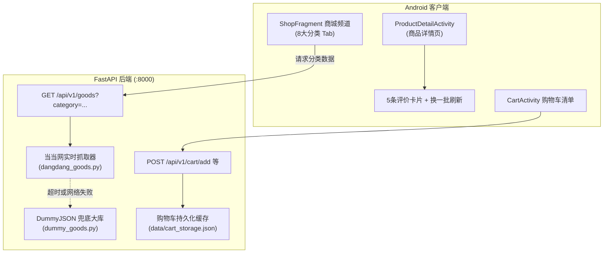

# 当当网实时商品抓取、批次评价与购物车持久化设计规范

## 1. 概述与设计目标

为了满足 Android 端“晴川 · 校园资讯与商城”课程设计的高真实度与强交互要求：
1. **实时抓取国内真实电商（当当网）**：与首页校园新闻爬虫一致，采用实时网络抓取机制，获取纯中文商品名、真实人民币价格、正品商品高清图片与累计评价数。
2. **完整对齐当当分类体系**：升级 App 商城频道的 8 大核心分类（推荐、图书、文具、服饰、运动、家居、食品、电器），各分类独立按需抓取。
3. **DummyJSON 自动兜底**：若外部网络异常或当当网波动，后端毫秒级无感降级到已调通的 DummyJSON（194 款商品）作为稳定兜底。
4. **评价展示规范（5 条/次，支持刷新切换）**：商品详情页一次展示 5 条真实排版中文评价，提供“换一批 / 刷新评价”按钮可循环切换下一批 5 条评价。
5. **购物车服务端持久化缓存**：不仅在内存维护购物车，且自动落盘持久化存储（`data/cart_storage.json`），包含商品快照（名称、单价、图片、分类），重启服务后购物车数据依然完整保留。

---

## 2. 系统架构设计



---

## 3. 当当网实时抓取器设计 (`dangdang_goods.py`)

### 3.1 分类与搜索映射
| App 分类 Tab | 当当网搜索关键词 | 对应商品类别说明 |
| :--- | :--- | :--- |
| **推荐** | `畅销热卖` | 综合全品类高热度正品 |
| **图书** | `计算机图书` | 计算机与大学教材热销图书 |
| **文具** | `学生文具` | 笔记本、中性笔、文具礼盒 |
| **服饰** | `男女服装` | 纯棉T恤、运动卫衣、外套 |
| **运动** | `运动户外` | 跑鞋、运动双肩包、运动外设 |
| **家居** | `家居日用` | 保温杯、床品四件套、护眼台灯 |
| **食品** | `休闲零食` | 混合坚果、冲饮黑咖啡、全脂牛奶 |
| **电器** | `数码电器` | 机械键盘、蓝牙耳机、大容量充电宝 |

### 3.2 HTML 节点解析规则
- **商品 ID**：提取 `<li id="11174259146">`，生成 `dangdang-11174259146`。
- **商品标题**：提取 `<p class="name"><a title="...">`。
- **价格提取**：优先提取百货类 `<span class="price_n">¥240.00</span>`；图书类自动回退提取 `<span class="search_now_price">¥69.80</span>`。转换为 float 及 cents。
- **图片链接**：提取 `<a class="pic">`，优先取 `data-original`，若无则取 `src`。自动补齐 `https:` 协议头。
- **销量与评分**：从 `<p class="search_star_line">` 提取评价量字符串（如 `29692条评论`），星级百分比换算为 `4.8 / 5.0`。
- **缓存策略**：设置 120 秒内存 TTL 缓存，防止频繁切换 Tab 导致高频重复请求。

### 3.3 兜底降级规范
- 请求超时时间：连接 3 秒，读取 5 秒。
- 若抓取异常或返回空列表，自动转调 `DummyGoodsCatalog.list()`，按对应分类映射输出，保证绝不返回 500 或 502。

---

## 4. 评价生成与“5条/次”刷新机制

### 4.1 评价数据模型
每个商品携带一个 `reviews` 数组（不少于 15 条优质真实中文评价库），字段契约：
```json
{
  "reviewerName": "晴川学子",
  "rating": 5,
  "comment": "发货很快，包装结实没有磕碰，实物做工精良，正品无疑！",
  "date": "2026-10-12"
}
```

### 4.2 客户端 5 条批次展示与交互
1. `ProductDetailsRenderer` 维护当前评价偏移量（`reviewOffset`）。
2. 初次进入展示 `[0..4]` 共 5 条评价。
3. 点击详情页评价卡片底部的 **“🔄 换一批评价 (5条/次)”** 按钮：
   - 偏移量增加 5：`offset = (offset + 5) % totalReviews`；
   - 动态更新当前 5 条评论条目；
   - 评论头像取评价人昵称首字，星级按评价真实打分高亮。

---

## 5. 购物车持久化与快照机制

### 5.1 数据文件
存储在 `data/cart_storage.json`，格式示例：
```json
{
  "items": {
    "dangdang-11174259146": {
      "count": 2,
      "updated_at": 1791895200,
      "snapshot": {
        "title": "机械键盘108键真机械合金版黑青红茶轴电竞有线",
        "price": 240.0,
        "image_url": "https://img3m6.ddimg.cn/...",
        "category": "电器",
        "image_res": "ic_shop"
      }
    }
  }
}
```

### 5.2 读写与恢复
- 服务端启动时自动读取该文件初始化 `cart_storage`。
- 每次收到 `/api/v1/cart/add`、`/api/v1/cart/update`、`/api/v1/cart/clear` 时，先更新内存再异步/同步落盘写入 JSON。
- 计算总价和商品列表时，优先使用保存时的快照，避免商品下线导致购物车崩溃。

---

## 6. Android 客户端改造

1. **`ShopFragment.java`**：
   - `TAB_LABELS` 调整为：`{"推荐", "图书", "文具", "服饰", "运动", "家居", "食品", "电器"}`。
   - `loadGoodsFromNetwork()` 传递 `?category=` 参数给 FastAPI 后端。
2. **`activity_product_detail.xml`**：
   - 在 `ll_review_rows` 容器下方增加 `btn_review_refresh`（换一批评价按钮）。
3. **`ProductDetailsRenderer.java`**：
   - 绑定 `btn_review_refresh` 点击监听器，实现 5 条一轮的循环刷新渲染。

---

## 7. 验证与测试计划

1. **Python 单元测试**：
   - `tests/test_dangdang_goods.py`：测试当当爬虫解析（标题、价格提取兼容性、图片协议补全、超时降级）。
   - `tests/test_cart_persistence.py`：测试购物车加购后重启后端服务，再次查询依然保留。
2. **FastAPI API 联调测试**：
   - 测试 `GET /api/v1/goods?category=图书` 等 8 个分类。
   - 测试断网/模拟网络异常时是否自动平滑降级为 DummyJSON。
3. **Android 编译与 UI 测试**：
   - 运行 `./gradlew.bat testDebugUnitTest` 验证客户端代码无语法或类型报错。
   - 验证详情页 5 条评价展示以及“换一批”点击响应。
